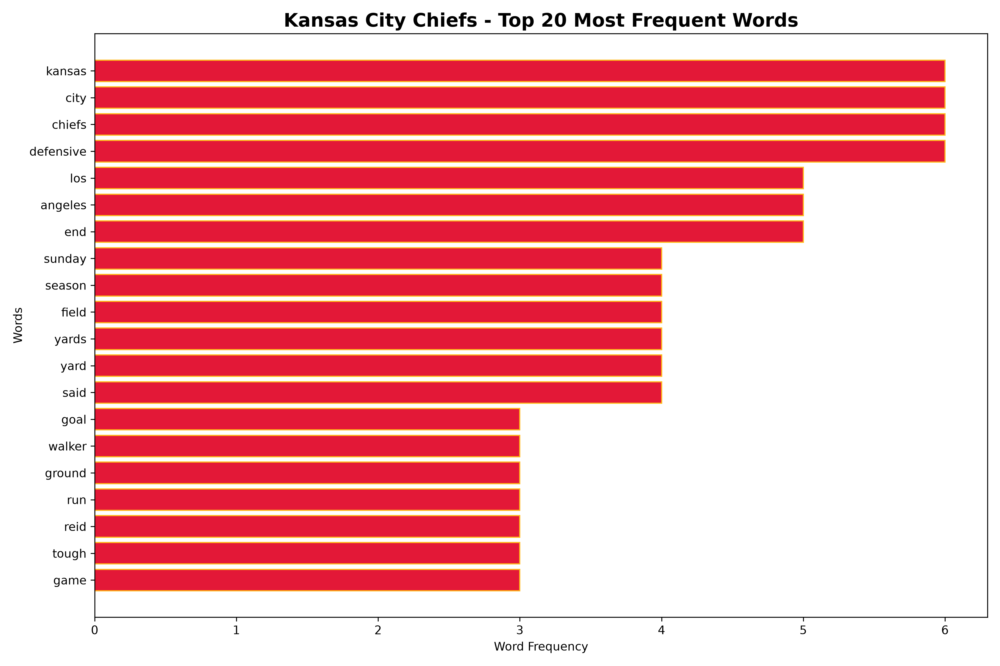
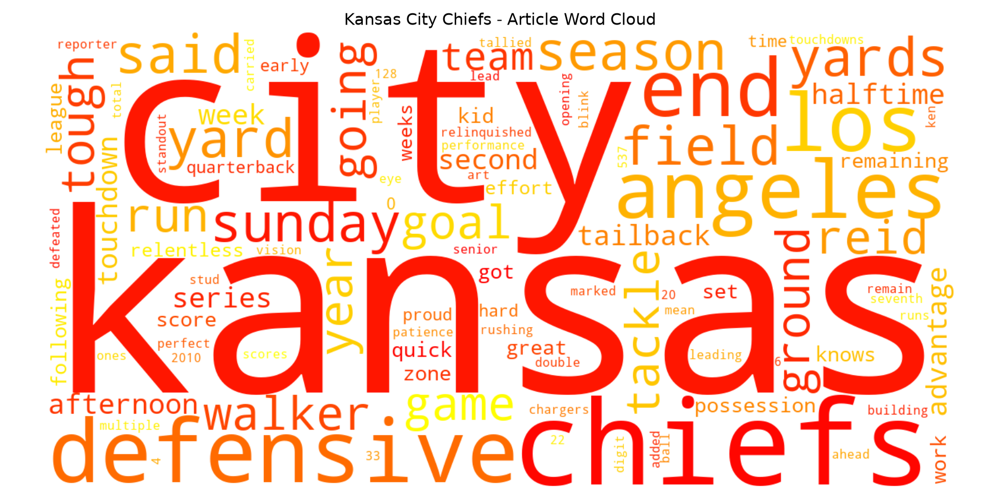

# nlp-06-nlp-pipeline

[](pyproject.toml)
[](https://github.com/johnjamez187/nlp-06-nlp-pipeline/actions/workflows/ci-python-zensical.yml)
[](https://johnjamez187.github.io/nlp-06-nlp-pipeline/)

[](https://docs.astral.sh/uv/)
[](https://docs.astral.sh/ty/)
[](https://zensical.org/)
[](LICENSE)

> Build a reproducible NLP pipeline for acquiring, processing, and analyzing Kansas City Chiefs web content.

## Project Overview

Author: John James

Date: 2026 November

Sixth project in the Web Mining and Applied NLP course.

This project demonstrates a complete natural language processing
(NLP) pipeline using a Kansas City Chiefs football article.

The goal is to retrieve HTML, validate document structure,
extract and clean text, engineer NLP features, visualize patterns,
and persist the results.

The project extends the EVTL approach from earlier modules
by adding an explicit Analyze stage.

Specifically, it reuses frequency analysis and charts from Module 01,
cleaning from Module 02, the stage pattern from Module 04,
and extraction from Module 05.

The resulting architecture is Extract, Validate, Transform,
Analyze, Load (EVTAL).

The project is configured in [pyproject.toml](pyproject.toml).

## Data

The customized project retrieves an article from the official
Kansas City Chiefs website.

Data source:

[Chiefs Defeat Chargers 22-6 to Move to 5-0](https://www.chiefs.com/news/chiefs-defeat-chargers-22-6-to-move-to-5-0-on-the-season)

The article discusses the Kansas City Chiefs victory over
the Los Angeles Chargers.

The extracted content contains:

- 655 original words.
- 17 article paragraphs.
- Football-related vocabulary.
- Descriptions of offensive and defensive performance.

The pipeline preserves the original HTML, extracts article content,
and produces a structured dataset with derived NLP features.

## Research Question

What words and themes appear most frequently in a Kansas City Chiefs
football article after applying natural language processing techniques?

The analysis also examines vocabulary diversity and the impact
of text preprocessing on the original article.

## Approach

The project uses a modular Python pipeline to acquire, validate,
transform, analyze, and save web document data.

The pipeline has five stages:

1. **Extract** - Retrieve HTML from the Chiefs website.
2. **Validate** - Verify required HTML elements and article content.
3. **Transform** - Extract metadata, clean text, and calculate NLP features.
4. **Analyze** - Examine token frequencies and generate visualizations.
5. **Load** - Save the processed dataset to a CSV file.

The project uses Requests for HTTP acquisition,
BeautifulSoup for HTML parsing,
spaCy for linguistic text processing,
Pandas for tabular data,
and Matplotlib and WordCloud for visualization.

The Transform stage demonstrates:

- Tokenization and text normalization.
- Punctuation and stop-word removal.
- Article word counts.
- Paragraph counts.
- Cleaned token counts.
- Unique token counts.
- Type-token ratios.

Explore these important project components:

- [pyproject.toml](pyproject.toml) - Project identity, dependencies, and tool configuration.
- [src/nlp/pipeline_web_html.py](src/nlp/pipeline_web_html.py) - Main EVTAL pipeline orchestrator.
- [src/nlp/config.py](src/nlp/config.py) - Web page and path configuration.
- [src/nlp/stage01_extract.py](src/nlp/stage01_extract.py) - Retrieve HTML.
- [src/nlp/stage02_validate.py](src/nlp/stage02_validate.py) - Validate HTML structure.
- [src/nlp/stage03_transform.py](src/nlp/stage03_transform.py) - Clean text and engineer NLP features.
- [src/nlp/stage04_analyze.py](src/nlp/stage04_analyze.py) - Analyze token frequencies and generate visualizations.
- [src/nlp/stage05_load.py](src/nlp/stage05_load.py) - Save processed results.
- [tests/](tests/) - Automated tests.
- [.github/workflows/](.github/workflows/) - Automated testing and documentation deployment.
- [docs/](docs/) - Project documentation.
- [zensical.toml](zensical.toml) - Documentation configuration.

## spaCy Pipeline

The project uses [spaCy](https://spacy.io/)
for tokenization and for identifying stop words and punctuation.

The project uses the `en_core_web_sm`
small English trained pipeline.

The package is declared in [pyproject.toml](pyproject.toml)
and installs with the project dependencies.

The pipeline splits text into tokens and removes stop words
and punctuation to prepare the article for analysis.

Text preprocessing remains useful in modern NLP,
particularly when creating inspectable and repeatable
analysis pipelines.

## Technical Modification

The original project analyzed an academic article from arXiv.

I modified the project to analyze a Kansas City Chiefs
football article instead.

I also customized the visualizations to represent
the Kansas City Chiefs team colors.

The modifications included:

- Changing the source URL to the Chiefs website.
- Customizing the generated output filenames.
- Creating a red horizontal bar chart with gold outlines.
- Using warm colors for the word cloud.
- Increasing visualization resolution to 300 DPI.
- Updating the project documentation to reflect the custom analysis.

### Prediction

I predicted that the pipeline would successfully process
the Chiefs article, generate different word frequencies,
and display the visualizations using the customized colors.

### Actual Results

The pipeline successfully processed the article and generated
the customized word frequency chart and word cloud.

All automated tests and code-quality checks passed.

### Lessons Learned

I learned how to customize visualizations using Matplotlib
and WordCloud.

I also learned that an existing NLP pipeline can be applied
to different web content without significantly changing
its underlying architecture.

## Run the Project

Follow the [Professional Python Workflow Guide](https://denisecase.github.io/pro-analytics-02/)
to set up your machine and project environment.

From a VS Code terminal in the project root,
install the project dependencies:

```shell
uv sync
```

Run the complete EVTAL pipeline:

```shell
uv run python -m nlp.pipeline_web_html
```

The pipeline automatically generates and saves the word
frequency chart and word cloud in `data/processed/`.

### View Generated Visualizations

Windows PowerShell users can open the generated
visualizations using the following commands:

```powershell
Invoke-Item .\data\processed\chiefs_top_tokens.png
Invoke-Item .\data\processed\chiefs_wordcloud.png
```

The visualizations are also available in the
Data Visualizations section below and on the
[hosted documentation site](https://johnjamez187.github.io/nlp-06-nlp-pipeline/).

## Results

The customized pipeline successfully retrieved, validated,
transformed, analyzed, and saved the Kansas City Chiefs article.

The analysis produced the following results:

| Metric | Result |
| --- | ---: |
| Original word count | 655 |
| Article paragraphs | 17 |
| Cleaned tokens | 328 |
| Unique tokens | 227 |
| Type-token ratio | 0.6921 |
| Vocabulary diversity | 69.21% |
| Characters removed during preprocessing | 41.5% |

The following files are created:

- `project.log` - Pipeline execution log.
- `data/raw/chiefs_raw.html` - Original HTML document.
- `data/processed/chiefs_processed.csv` - Processed NLP dataset.
- `data/processed/chiefs_top_tokens.png` - Token frequency bar chart.
- `data/processed/chiefs_wordcloud.png` - Word cloud visualization.

These artifacts provide evidence of successful data acquisition,
validation, transformation, analysis, and persistence.

## Data Visualizations

### Top 20 Most Frequent Words



The frequency chart displays the 20 most common tokens
after text preprocessing.

The red bars and gold outlines were selected to represent
the Kansas City Chiefs team colors.

The most frequently occurring words included:

| Word | Frequency |
| --- | ---: |
| Kansas | 6 |
| City | 6 |
| Chiefs | 6 |
| Defensive | 6 |
| Los | 5 |
| Angeles | 5 |
| End | 5 |

The frequency of the word defensive suggests that defensive
performance was an important theme in the article.

### Word Cloud



The word cloud visually represents the frequency of words
in the cleaned article.

Larger words represent more frequently occurring tokens.

Football-related terms such as defensive, yards, field,
and run highlight the article's discussion of game performance.

## Analysis and Interpretation

The original article contained 655 words.
After preprocessing, the article contained 328 cleaned tokens,
including 227 unique tokens.

The type-token ratio was calculated by dividing the number
of unique tokens by the total number of cleaned tokens.

227 / 328 = 0.6921

This represents a diversity of 69.21% cleaned tokens that were distinct.
This removed about 41.5% of the original characters.

The frequency chart and word cloud suggest that defensive
performance was an important theme in the article.

## Limitations

This analysis examined only one Kansas City Chiefs article.
It also couldn't tell if the defensive performance was good or poor.


## Verification

The following commands were used to verify the project:

```shell
uv run ruff check . --fix
uv run ruff format .
uv run ty check
uv run pytest -q
uv run python -m nlp.pipeline_web_html
uv run python -m zensical build
```

Verification results:

| Verification | Result |
| --- | --- |
| Ruff linting | Passed |
| Ruff formatting | Passed |
| Type checking | Passed |
| Pytest | 1 passed |
| Total code coverage | 82.44% |
| EVTAL pipeline | Successfully executed |
| Documentation build | Passed |
| Git hooks | Passed |
| GitHub CI | Passed |
| GitHub Docs Deploy | Passed |

## Project Documentation

The [hosted documentation site](https://johnjamez187.github.io/nlp-06-nlp-pipeline/)
is published using Zensical and GitHub Pages.

The documentation site presents the project report,
including data, methods, results, visualizations,
interpretation, and conclusions.

For additional context about traditional NLP
and modern language-model approaches,
see [NLP Evolution](docs/nlp-evolution.md).

## CI/CD and GitHub Actions

This project includes continuous integration and continuous
deployment (CI/CD) to check project files and publish the docs.

GitHub Actions include:

- [CI: Python and Documentation Checks](https://github.com/johnjamez187/nlp-06-nlp-pipeline/actions/workflows/ci-python-zensical.yml)
- [CD: Documentation Deployment](https://github.com/johnjamez187/nlp-06-nlp-pipeline/actions/workflows/deploy-zensical.yml)

## Developer Reference

Follow the
[Professional Python Workflow Guide](https://denisecase.github.io/pro-analytics-02/)
for **detailed instructions and troubleshooting**.

### Initialize and Update the Python Environment

With the project open in VS Code, open a VS Code terminal.

Paste each command and hit Enter or Return after to run it.

```shell
uvx pup-clean --delete
uv self update
uv python pin 3.14
uv python install
uv lock --upgrade
uv sync
uv audit
```

### Set Up and Run Git Hooks

Set up and run the Git hooks to perform basic checks
automatically before changes get pushed to GitHub.

```shell
uvx prek install --force
uvx prek update --freeze --cooldown-days 7

git add -A
uvx prek run --all-files
# repeat if changes were made
uvx prek run --all-files
```

### Run Common Chores

Run linters, formatters, type checks, tests,
and build the documentation.

```shell
uv run ruff check . --fix
uv run ruff format .

uv run ty check
uv run python -m pytest
uv run python -m zensical build
```

### Git add-commit-push to GitHub

After making useful changes, save your work to GitHub.

```shell
git add -A
git commit -m "describe your changes in quotes"
git push -u origin main
```

## Developer Notes

- Use the **UP ARROW** and **DOWN ARROW** in the terminal to scroll through past commands.
- Use `CTRL+F` to find text within a file.

## Developer Tools

This project uses professional Python tools to support
development, testing, documentation, and code quality.

- [uv](https://docs.astral.sh/uv/) - Python environments and dependencies.
- [Ruff](https://docs.astral.sh/ruff/) - Python linting and formatting, configured in [.ruff.toml](.ruff.toml).
- [ty](https://docs.astral.sh/ty/) - Python type checking.
- [pytest](https://docs.pytest.org/) - Automated Python testing, configured in [.pytest.toml](.pytest.toml).
- [prek](https://prek.j178.dev/) - Git hooks and automated checks, configured in [prek.toml](prek.toml).
- [Zensical](https://zensical.org/) - Project documentation, configured in [zensical.toml](zensical.toml).

## Links

- [GitHub Repository](https://github.com/johnjamez187/nlp-06-nlp-pipeline)
- [Hosted Documentation](https://johnjamez187.github.io/nlp-06-nlp-pipeline/)
- [Kansas City Chiefs Data Source](https://www.chiefs.com/news/chiefs-defeat-chargers-22-6-to-move-to-5-0-on-the-season)
- [Technical Modification Commit](https://github.com/johnjamez187/nlp-06-nlp-pipeline/commit/7e293a4)
- [Processed Data](data/processed/)
- [Professional Python Workflow Guide](https://denisecase.github.io/pro-analytics-02/)
- [Citation](CITATION.cff)
- [License](LICENSE)
