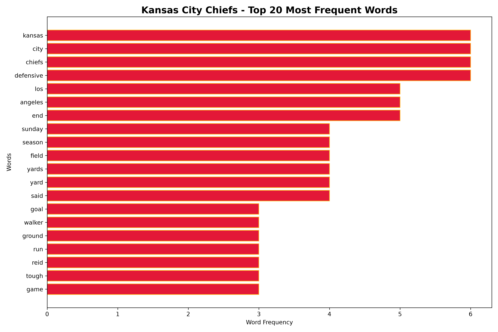
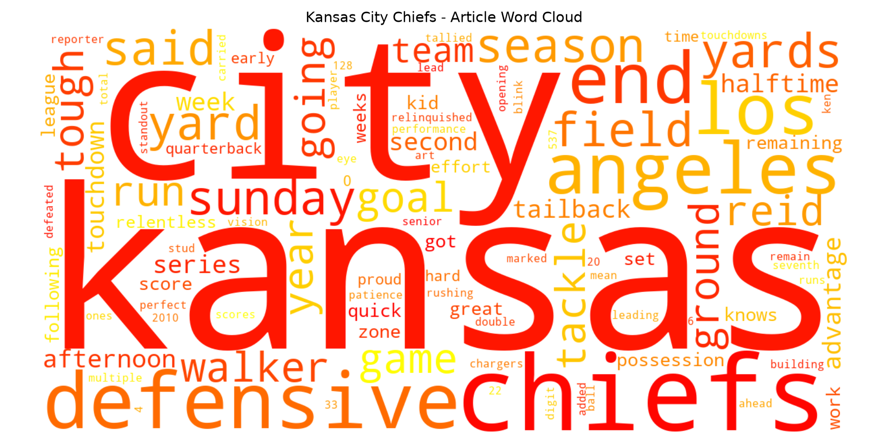

# Web Mining and Applied NLP Project Report

**John James | Project 06 | Kansas City Chiefs NLP Analysis**

## Overview

This project demonstrates a complete natural language processing
(NLP) pipeline using a Kansas City Chiefs football article.

The objective is to retrieve web content, validate the HTML,
extract and clean text, analyze vocabulary patterns,
and save the results.

The project uses the Extract, Validate, Transform, Analyze,
Load (EVTAL) architecture.

## Tools and Methods

The project uses:

- Python for pipeline orchestration.
- Requests for retrieving HTML documents.
- BeautifulSoup for parsing HTML content.
- spaCy for text preprocessing and tokenization.
- Pandas for structured data processing.
- Matplotlib for token frequency visualizations.
- WordCloud for visual vocabulary analysis.
- CSV for saving processed data.
- Ruff, ty, and pytest for code verification.
- Zensical and GitHub Pages for documentation.

### Data Source

The analysis uses a Kansas City Chiefs article:

[Chiefs Defeat Chargers 22-6 to Move to 5-0](https://www.chiefs.com/news/chiefs-defeat-chargers-22-6-to-move-to-5-0-on-the-season)

### Pipeline Stages

1. **Extract:** Retrieve the Chiefs article and save its HTML.
2. **Validate:** Verify the HTML structure and article content.
3. **Transform:** Extract, clean, and tokenize the text.
4. **Analyze:** Calculate token frequencies and create charts.
5. **Load:** Save the processed data and visualizations.

## Verification

The customized pipeline executed successfully.

The analysis produced:

- **Raw words:** 655
- **Article paragraphs:** 17
- **Cleaned tokens:** 328
- **Unique tokens:** 227
- **Type-token ratio:** 0.6921

### Generated Files

- `data/raw/chiefs_raw.html`
- `data/processed/chiefs_processed.csv`
- `data/processed/chiefs_top_tokens.png`
- `data/processed/chiefs_wordcloud.png`

Automated tests and code-quality checks provide additional
verification of the pipeline.

## Interpretation

The analysis demonstrates how NLP techniques can identify
recurring vocabulary in a sports article.

Token frequencies help reveal which words appear most often,
while the type-token ratio measures vocabulary diversity.

The type-token ratio of approximately 0.69 indicates that
the cleaned article contains a relatively diverse vocabulary.

The token frequency chart and word cloud provide visual
representations of the article's vocabulary.

These results demonstrate how an automated NLP pipeline
can transform unstructured sports reporting into
structured information suitable for analysis.

## Documentation Index

- [Home](index.md)
- [Project Instructions](project-instructions.md)
- [Glossary](glossary.md)
- [NLP Evolution](nlp-evolution.md)

## Project Links

- [GitHub Repository](https://github.com/johnjamez187/nlp-06-nlp-pipeline)
- [NLP Pipeline](https://github.com/johnjamez187/nlp-06-nlp-pipeline/blob/main/src/nlp/pipeline_web_html.py)
- [Project Configuration](https://github.com/johnjamez187/nlp-06-nlp-pipeline/blob/main/src/nlp/config.py)
- [Transform Stage](https://github.com/johnjamez187/nlp-06-nlp-pipeline/blob/main/src/nlp/stage03_transform.py)
- [Analyze Stage](https://github.com/johnjamez187/nlp-06-nlp-pipeline/blob/main/src/nlp/stage04_analyze.py)
- [Published Documentation](https://johnjamez187.github.io/nlp-06-nlp-pipeline/)

## Project Resources

- [Project Instructions](project-instructions.md)
- [NLP Evolution](nlp-evolution.md)
- [Professional Python Guide](https://denisecase.github.io/pro-analytics-02/)
- [Professional Python Project Explainer](https://pup-pack.github.io/professional-python-project-explainer/)

## Data Visualizations

### Top 20 Most Frequent Words

The frequency chart displays the 20 most common tokens after
text preprocessing. Kansas, city, chiefs, and defensive were
the most frequent words, each appearing six times.

The red bars and gold outlines were selected to represent
the Kansas City Chiefs team colors.

### Word Cloud

The word cloud visually represents the frequency of words
in the cleaned article. Larger words represent more frequently
occurring tokens.

Football-related terms such as defensive, yards, field,
and run highlight the article's discussion of game performance.

### Key Insights

- Original article word count: 655
- Paragraph count: 17
- Cleaned token count: 328
- Unique token count: 227
- Vocabulary diversity: 69.21%
- Characters removed during preprocessing: 41.5%

The visualizations suggest that defensive performance was
an important theme in the article.

### Project Verification

- Ruff linting: Passed
- Ruff formatting: Passed
- Type checking: Passed
- Pytest: 1 passed
- Total code coverage: 82.44%
- EVTAL pipeline: Successfully executed
